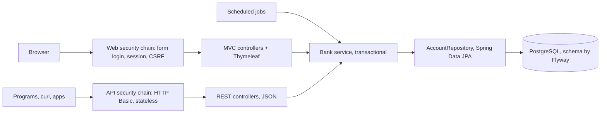
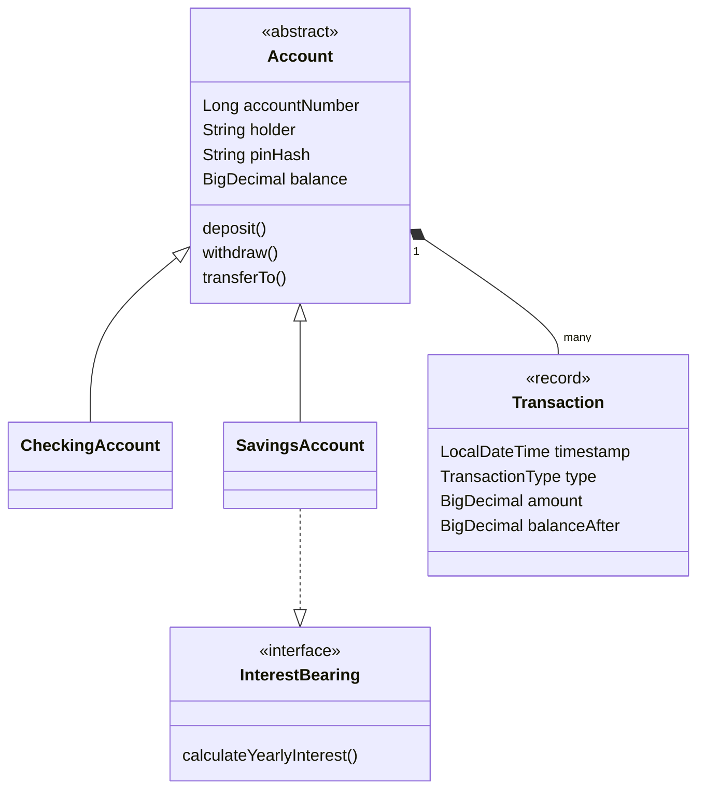

# Mini Bank

A small banking web application built step by step to practice **Java fundamentals** and the **Spring ecosystem**.
It started as a plain-Java console program and grew into a secured Spring Boot web app with a PostgreSQL database, fully runnable in Docker.

> Learning project, not a real bank system. Built as part of my career change into Java backend development.

## Features

**Customers** (log in with account number + 4-digit PIN)
- Dashboard with balance, available amount (including overdraft) and remaining daily withdrawal limit
- Deposit, withdraw and transfer money to another account
- Full account statement with running balance and totals

**Administrator**
- Open checking or savings accounts, close empty accounts
- Search accounts by holder, see bank-wide statistics (total deposits, richest account, customers)
- Start a new day (resets daily limits) and pay yearly interest to savings accounts

**REST API** (JSON, for programs and mobile apps)
- Customers: read account and statement, deposit, withdraw, transfer
- Administrators: list, search, open and close accounts
- Standard error responses (RFC 9457 problem details) with meaningful status codes

**Automated jobs**
- A new banking day starts automatically at midnight (Athens time)
- Yearly interest is paid to savings accounts every 1 January

**Business rules**

| Account type | Daily withdrawal limit | Extra |
| --- | --- | ---|
| Checking | 500.00 EUR | Overdraft up to 200.00 EUR |
| Savings | 200.00 EUR | 3% yearly interest |

Amounts are displayed in Greek format (e.g. `45.000,00`).

## Tech stack

| Area | Technology |
| ---| ---|
| Language | Java 25 |
| Framework | Spring Boot 4.1 (Spring MVC, Sprin Security, Spring Data JPA / Hibernate) |
| Views | Thymeleaf, HTML , CSS (flexbox and grid, no CSS framework) |
| Database | PostgreSQL 18 |
| Security | Form login with custom `AuthenticationProvider`, roles, CRSF protection, BCrypt-hashed PINs |
| Build | Maven |
| Containers | Docker (multi-stage build), Docker Compose |
| REST API | `@RestController`, JSON DTOs (records), HTTP Basic, stateless, RFC 9457 `ProblemDetail` |
| Validation | Jakarta Bean Validation (Hibernate Validator), custom `@Pin` constraint |
| Schema migrations | Flyway (`ddl-auto=validate`) |
| Scheduling | Spring `@Scheduled` with cron expressions |
| Testing | JUnit 5, MockMvc, Spring Security Test, H2 (in-memory, test profile) |

## Quick start (Docker only)

Requires only [Docker Desktop](https://www.docker.com/products/docker-desktop/).

```bash
git clone https://github.com/GiorgosFoteinopoulos/Mini-bank-project.git
cd Mini-bank-project
cp .env.example .env #Windows cmd: copy .env.example .env
docker compose --profile app up -d --build
```

Open **http://localhost:8080**. On first start the database is seeded with demo data:

| Role | Login | PIN / password |
| --- | --- | ---|
| Customer (checking) | `1001` | `1234` |
| Customer (savings) | `1002` | `5678` |
| Customer (savings) | `1003` | `4321` |
| Administrator | `admin` | value of `ADMIN_PASSWORD` (default `admin123`)

Stop everything with `docker compose --profile app down` (your data is kept in a Docker volume).

## Development setup

Run only the database in Docker and the application from the IDE:

```bash
docker compose up -d  # PostgreSQL on localhost:5435
```

Then run `MiniBankWebApplication` from IntelliJ with the environment variable `DB_PASSWORD` set
(or from the terminal, e.g. PowerShell: `$env:DB_PASSWORD="..."; mvn spring-boot:run`).

Optional database GUI:

```bash
docker compose --profile tools up -d #pgAdmin on http://localhost:5050
```

In pgAdmin, register the server with host `db`, port `5432`, user `postgres`.
> Do not run the app in the IDE and the `app` container at the same time: both use port 8080.

### Compose profiles

| Command | Starts |
| --- | --- |
| `docker compose up -d` | database |
| `docker compose --profile app up -d --build` | database + application |
| `docker compose --profile tools up -d` | database + pgAdmin |

###  Configuration

| Variable | Required | Default | Used for |
| ---| ---| ---| ---|
| `DB_PASSWORD` | yes | | PostgreSQL password |
| `PGADMIN_PASSWORD` | only with `tools` | | pgAdmin login |
| `ADMIN_PASSWORD` | no | `admin123` | Bank administrator login |
| `DB_URL` | no | `jdbc:postgresql://localhost:5435/minibank` | Overridden to `db:5432` inside Docker |
| `DB_USERNAME` | no | `postgres` | Database user |
| `NEW_DAY_CRON` | no | `0 0 0 * * *` | When the daily limits reset (Spring cron, Athens time) |
| `INTEREST_CRON` | no | `0 0 0 1 1 *` | When yearly interest is paid |

Secrets live in `.env`, which is git-ignored. `.env.example` lists the variables.

## REST API

All endpoints live under `/api`, use JSON and **HTTP Basic** authentication (stateless, no session).
Money is sent and returned as strings (e.g. `"50.00"`) to avoid floating-point errors.

### Customer endpoints (log in with account number + PIN)

| Method | URL | Body | Response |
|---|---|---|---|
| `GET` | `/api/me/account` | | `200` account |
| `GET` | `/api/me/transactions` | | `200` statement, newest first |
| `POST` | `/api/me/deposits` | `{"amount": "50.00"}` | `200` updated account |
| `POST` | `/api/me/withdrawals` | `{"amount": "20.00"}` | `200` updated account |
| `POST` | `/api/me/transfers` | `{"targetAccount": 1003, "amount": "10.00"}` | `200` updated account |

### Admin endpoints

| Method | URL | Response |
|---|---|---|
| `GET` | `/api/accounts?q=` | `200` all accounts, optionally filtered by holder |
| `GET` | `/api/accounts/{number}` | `200` / `404` |
| `POST` | `/api/accounts` | `201 Created` + `Location` header |
| `DELETE` | `/api/accounts/{number}` | `204 No Content` / `404` / `409` if not empty |

### Errors

| Status | When |
|---|---|
| `400` | Invalid fields or malformed JSON (field errors listed in `errors`) |
| `401` / `403` | Missing or wrong credentials / wrong role |
| `404` | Unknown account |
| `409` | Account not empty, or a concurrent update |
| `422` | Business rule broken: insufficient funds, daily limit, transfer to own account |

### Examples

```bash
curl -u 1001:1234 http://localhost:8080/api/me/account

curl -u 1001:1234 -H "Content-Type: application/json" \
     -d '{"amount": "50.00"}' http://localhost:8080/api/me/deposits

curl -u admin:admin123 http://localhost:8080/api/accounts
```

## Running the tests

```bash
mvn test
```

The API tests use an in-memory H2 database (`test` profile), so Docker and PostgreSQL are not needed.

## Architecture

A thin layered architecture: controllers only translate HTTP, all business rules live in the domain classes and the `Bank` service.




### Domain model



- **Single-table inheritance**: both account types live in one `account` table, distinguished by an `account_type` column.
- **Transactions** are an embedded value type (`@ElementCollection`) owned by their account, kept in order.
- **Account numbers** come from a database sequence starting at 1001.
- **Optimistic locking** (`@Version`) prevents lost updates when two requests change the same account.

### Project structure

```
src/main/java/com/practice/bank
├── MiniBankWebApplication.java   Spring Boot entry point
├── Account, CheckingAccount, SavingsAccount, InterestBearing
├── Transaction, TransactionType  value types
├── Bank.java                     service: business operations, transactions
├── AccountRepository.java        Spring Data JPA repository
├── DemoDataSeeder.java           demo data on an empty database
├── exception/                    BankException and its subclasses
├── web/                          MVC controllers, security, forms, money formatting
│   └── validation/               custom @Pin constraint
├── api/                          REST controllers, DTOs, API security, error handling
└── jobs/                         scheduled jobs
src/main/resources
├── db/migration/                 Flyway migrations (V1 baseline, V2 check constraints)
├── templates/                    Thymeleaf pages and layout fragments
├── static/css/style.css
├── messages.properties
└── application.properties
src/test
├── java/.../api/ApiTest.java     MockMvc tests for the REST API
└── resources/application-test.properties
```

### Docker image

The `Dockerfile` uses a **multi-stage build**: a Maven + JDK image compiles the jar, and only the jar is copied into a slim JRE image that runs as a non-root user.
Build tools and source code never reach the final image.

## Learning journey

| Part | Topics | Where |
|---|---|---|
| A: Console app | JVM, types, `BigDecimal`, methods, loops, classes, collections, exceptions, inheritance, interfaces, enums, records, streams, `Optional`, `java.time` | tag [`part-a-console`](../../tree/part-a-console) |
| B: Web app | Spring Boot, dependency injection, Thymeleaf, Post/Redirect/Get, Spring Security, JPA and PostgreSQL, transactions, Docker | tag [`part-b-web`](../../tree/part-b-web) |
| C: Professional backend | Bean Validation and custom constraints, REST API with DTOs and problem details, a second security chain, MockMvc tests, Flyway migrations, scheduled jobs | tag [`v1.0`](../../tree/v1.0) |

Possible extensions: JWT authentication, idempotency keys for payments, Testcontainers instead of H2.

## Author

**Giorgos Foteinopoulos**, [GitHub](https://github.com/GiorgosFoteinopoulos)